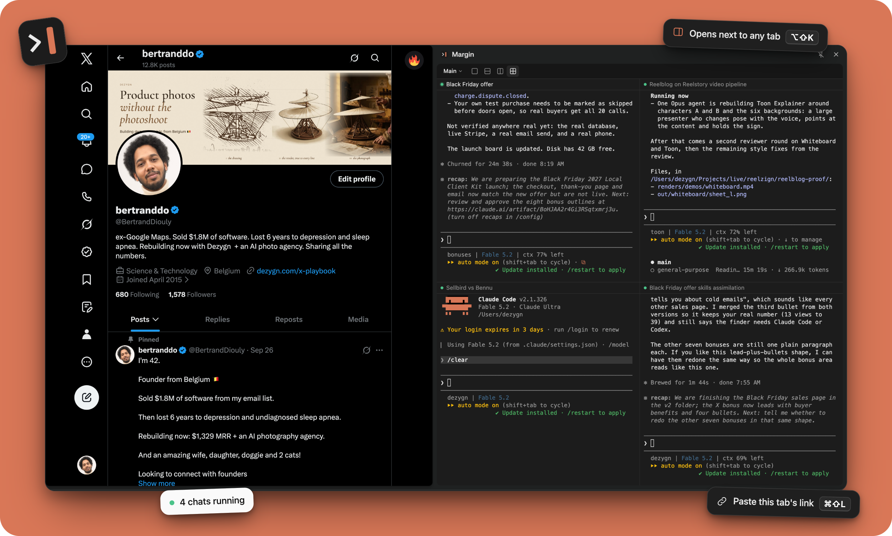
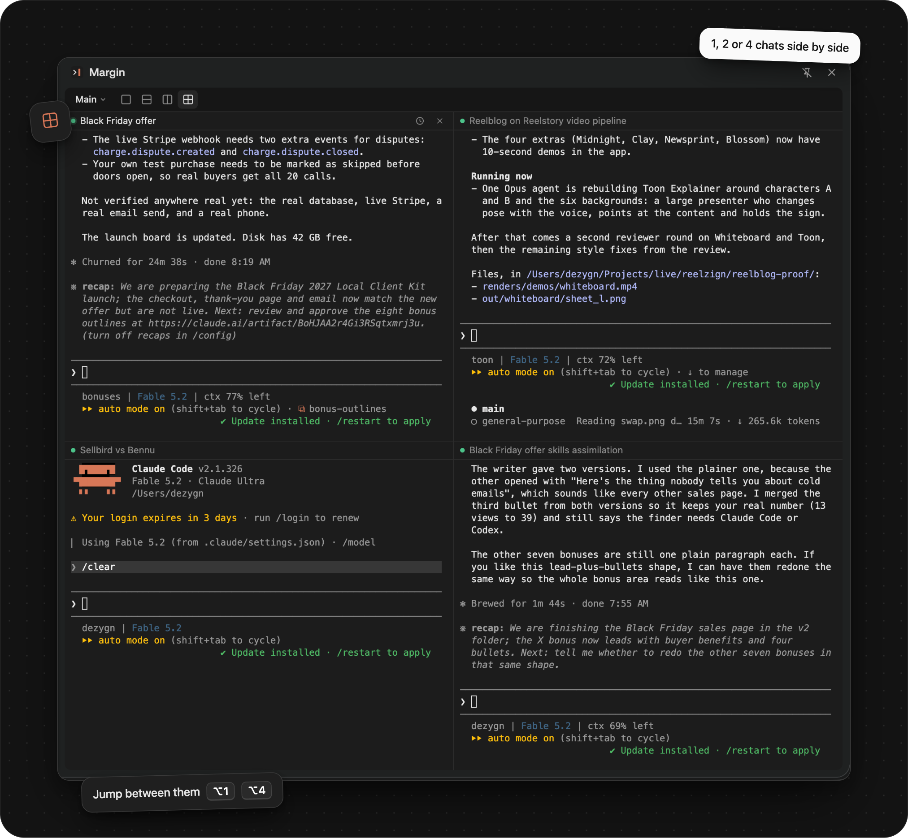
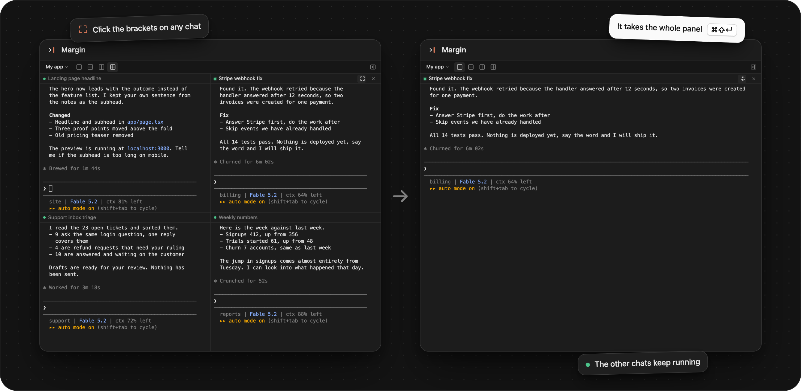
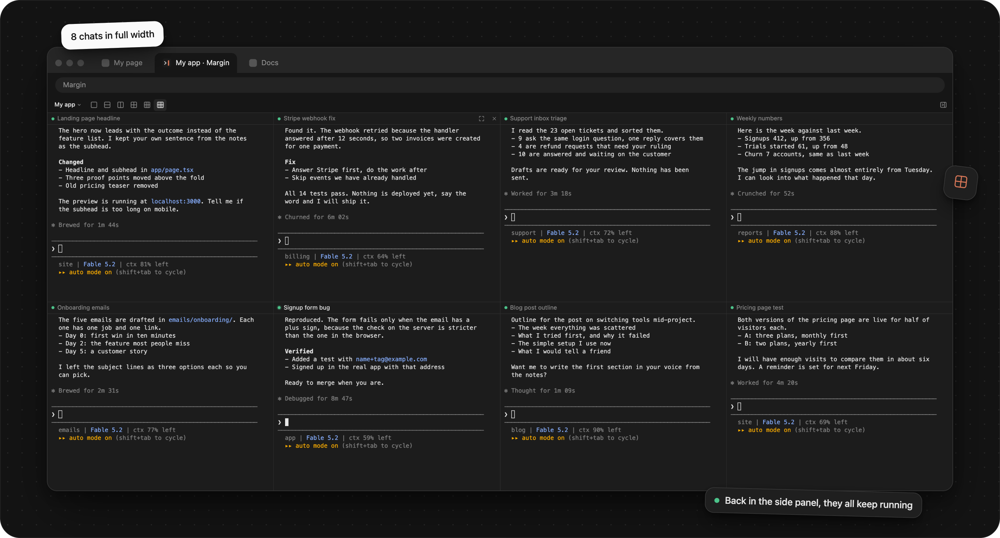
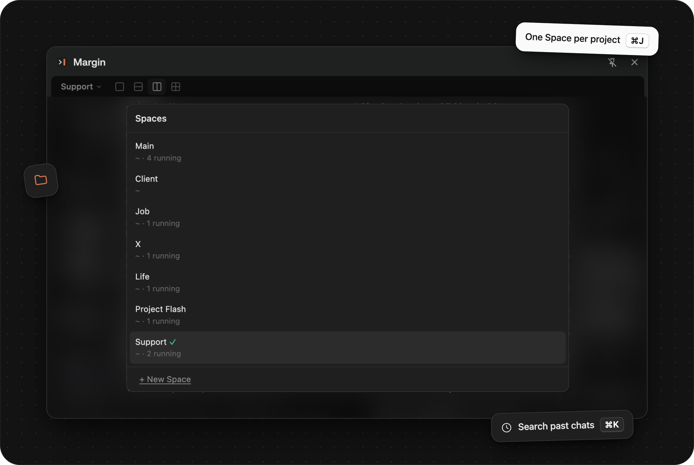
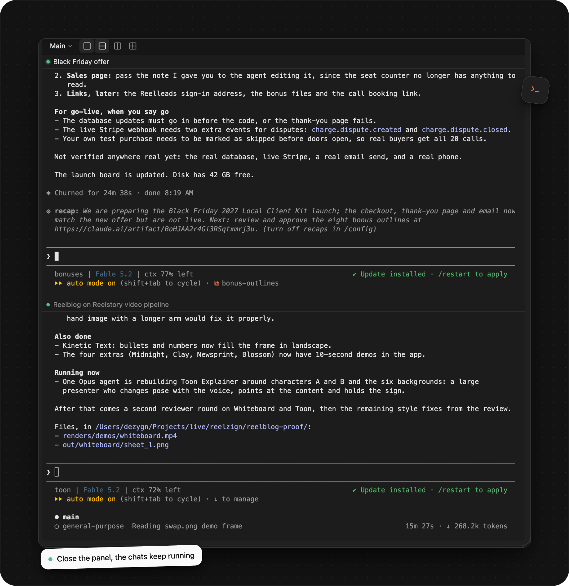
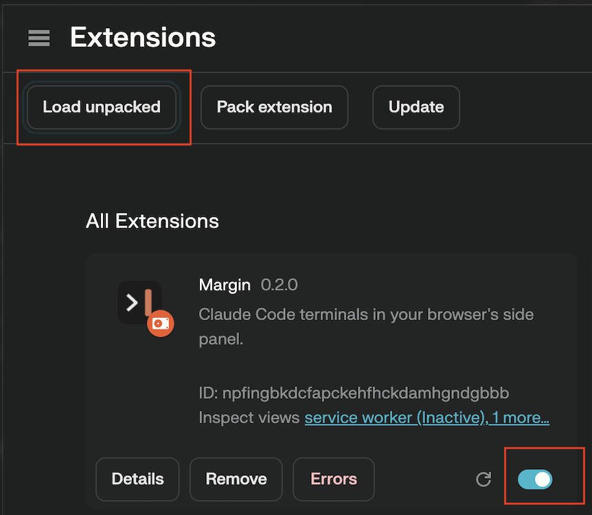
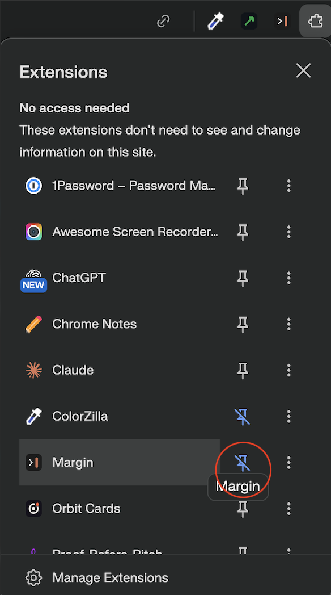

<p align="center"></p>

<h1 align="center">Margin</h1>

<p align="center">Bring the Claude Code terminal into your browser.</p>

<p align="center"></p>

I work in Claude Code all day, and I kept switching between the terminal and the browser. A tab to check, a link to copy, then back to the terminal, all day long.

So I built Margin for myself. It puts real Claude Code terminals in your browser's side panel, right next to whatever tab you are on.

It runs the real `claude` command on your own machine, so you keep your own Claude subscription, your skills, your memory and your MCP servers. Nothing is reinvented and nothing goes through a server of mine.

I have used nothing else for a month now. It is deliberately very simple. Ultra simple, but for simple users like me it's perfect.

## What it does

**It opens in the side panel next to any tab.** Click the Margin icon in your toolbar or press Option+Shift+K.

**You can run up to eight chats at once.** In the side panel, pick 1 chat, 2 stacked, 2 side by side, or 4. In full width you can also pick 6 or 8. Chats you hide keep running in the background.

<p align="center"></p>

**Any chat can take the full space of Margin, and that is my favourite feature.** If you have the 4 chat layout, hover any chat and click the full size button in its title bar, the one with the corner brackets. That chat then takes the whole panel while the other chats keep running, hidden. Click the button again and you are back in the layout you came from, with every chat in its old place. You can also press Cmd+Shift+Enter or double click the title bar. I use it when four chats are running and one needs my attention.

<p align="center"></p>

**Margin can also use the whole width of your window.** The browser limits a side panel to about half the window, so I added a button at the right end of Margin's top bar, or Option+Shift+F, that opens Margin in a tab of its own. It stays in the same Space with the same chats, and nothing stops. The same button or shortcut brings you back to the side panel, on the page you came from, and in full width Cmd+Shift+L pastes the link of that page. Full width also adds two more layouts, 6 chats and 8 chats. If you go back to the side panel with more than four chats, it shows four of them, and the others keep running, hidden, and are back in place when you return to full width.

<p align="center"></p>

**Spaces keep your work apart.** Press Cmd+J to switch between named sets of chats, for example Clients, Support, or your app. Each Space has its own layout and its own default folder for new chats. Each browser window shows one Space, so one desktop can be Clients and another one your app. You can rename Spaces, drag them to reorder, and delete the empty ones. Switching Space never stops a chat.

<p align="center"></p>

**You can reopen any past chat.** Press Cmd+K to search every past Claude Code chat on your machine, then use the arrow keys and Enter to reopen one in the pane. Chats that are still running show at the top.

**You can send Claude the page you are looking at.** Cmd+Shift+L pastes the current tab's link into the chat you are typing in.

**Chats can drive the browser.** Every chat starts with `claude --chrome`, so if you also have the Claude in Chrome extension, a chat can work in the browser it sits in.

**Closing the panel never kills a chat.** Reopen it and every chat is exactly where you left it, with the same screen. Only the X on a pane ends a chat.

<p align="center"></p>

**It runs on your subscription, not on API credit.** Before it starts `claude`, Margin removes `ANTHROPIC_API_KEY` from the environment, so a chat never quietly bills metered API credit.

**Everything stays on your Mac.** There is no account, no server of mine and no tracking. A small helper called the bridge runs on your Mac, listens on 127.0.0.1 port 5250 only, and only accepts connections from browser extensions.

## Keyboard shortcuts

| Shortcut | What it does |
| --- | --- |
| Option+Shift+K | Open the Margin panel |
| Cmd+J | Switch Space |
| Cmd+K | Search and reopen past chats |
| Cmd+Shift+L | Paste the current tab's link into the chat |
| Cmd+Shift+Enter | Make the chat you are in full size, and go back |
| Option+Shift+F | Switch between the side panel and full width |
| Option+1 to Option+8 | Jump between panes |

## Install

A Chrome Web Store version is coming. For now you load it yourself, which takes about two minutes.

1. [Download Margin](https://github.com/bertrand-do/margin/archive/refs/heads/main.zip) and unzip it.
2. Move the `margin-main` folder to your home folder. Don't leave it in Downloads, because Margin runs from this folder.
3. Open the Terminal app, drag the `install.sh` file from the folder into the Terminal window and press Enter. This starts the small helper that runs Claude Code, now and at every login.
4. Type `chrome://extensions` in your Chrome address bar and turn on **Developer mode** at the top right.
5. Click **Load unpacked** and pick the `extension` folder inside `margin-main`.
6. Check that the Margin switch is on.

<p align="center"></p>

7. Click the puzzle icon in your toolbar and pin Margin.

<p align="center"></p>

8. Click the Margin icon or press Option+Shift+K.

If you prefer git, steps 1 to 3 are just this:

```
git clone https://github.com/bertrand-do/margin.git
cd margin
./install.sh
```

## Update

Download Margin again and replace the folder (or run `git pull`), run `install.sh` again, then click the reload arrow on the Margin card in `chrome://extensions`.

Re-running the install restarts the bridge, which ends the chats that are running. You can reopen them from past chats with Cmd+K.

## Uninstall

Run `./uninstall.sh`, then remove the extension from `chrome://extensions`.

## What it needs

1. macOS.
2. Node.js 20 or newer.
3. Claude Code installed and logged in, so `claude` works in your Terminal.
4. Chrome or another Chromium browser with a side panel. I use it every day in a Chromium browser, and the tests run in Chrome.

## Limits

It only works on macOS for now. You get four chats on screen in the side panel, and a Space holds up to eight in full width. Side-loaded extensions do not update themselves, so you update by hand as shown above.

The bridge trusts any extension installed in your browser, so run Margin in a browser where you trust your extensions.

This is a personal tool I am sharing, not a company product.

## How it works

`bridge/server.mjs` is a small Node program (node-pty and WebSocket) that runs the real `claude` processes. It keeps a copy of each chat's screen, so a reopened panel gets the exact same screen back.

`extension/` is a Manifest V3 side panel built with xterm.js.

`test/` has the end-to-end checks.

## License

MIT, see [LICENSE](LICENSE).

## Feedback

I am [@BertrandDiouly](https://x.com/BertrandDiouly) on X. Issues are welcome here on GitHub.
